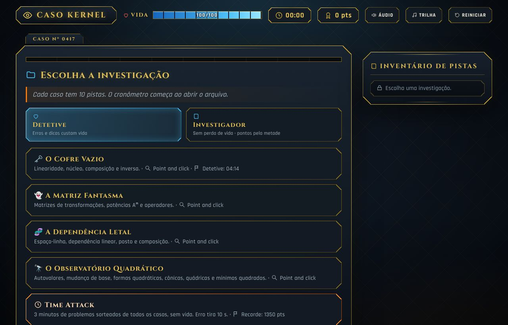
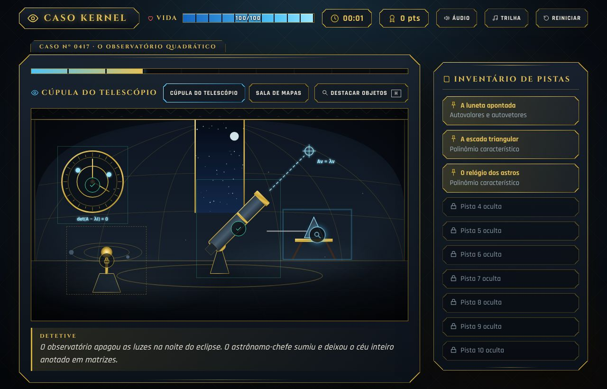
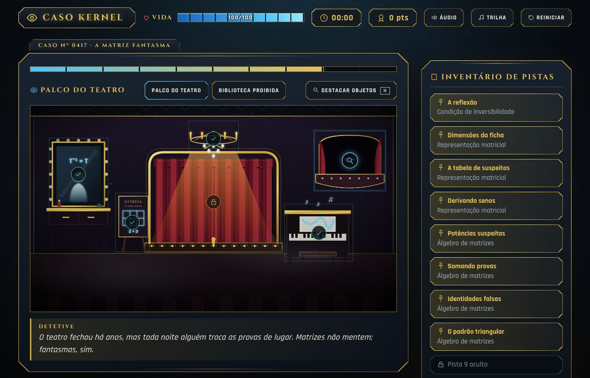
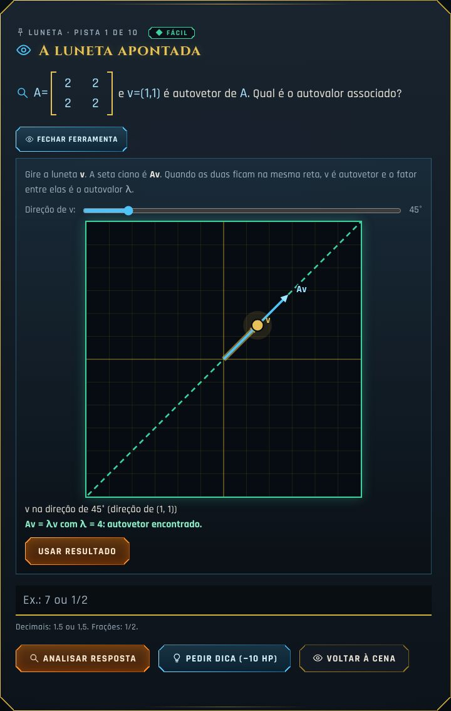
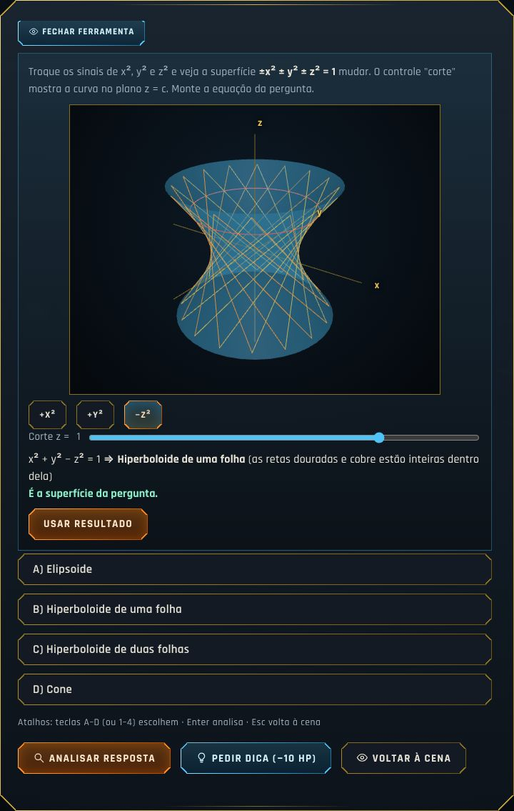
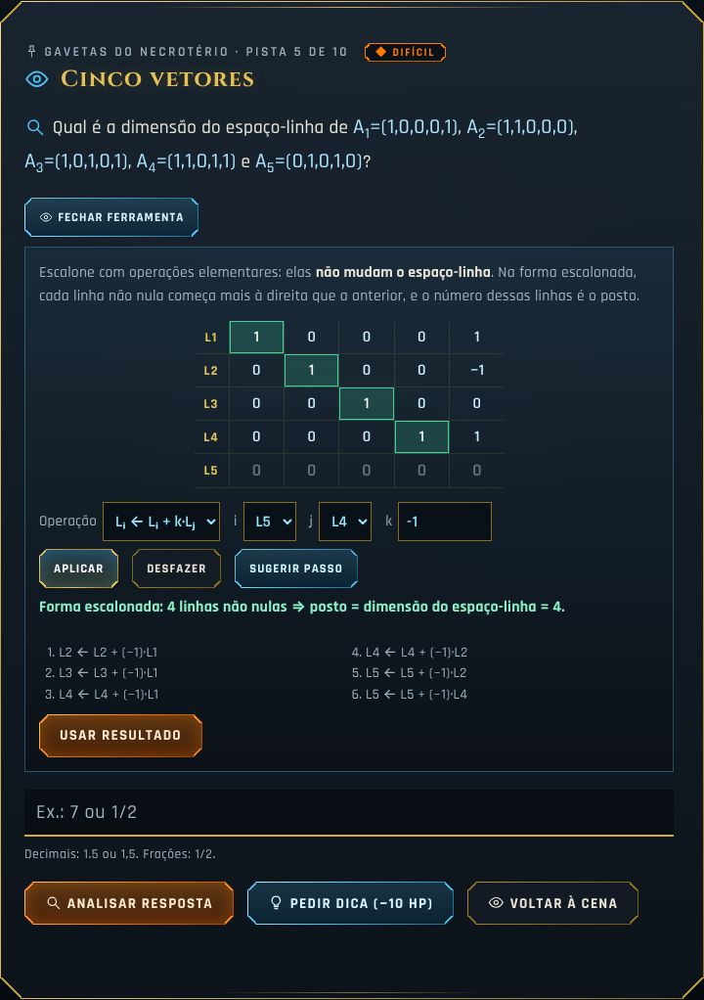
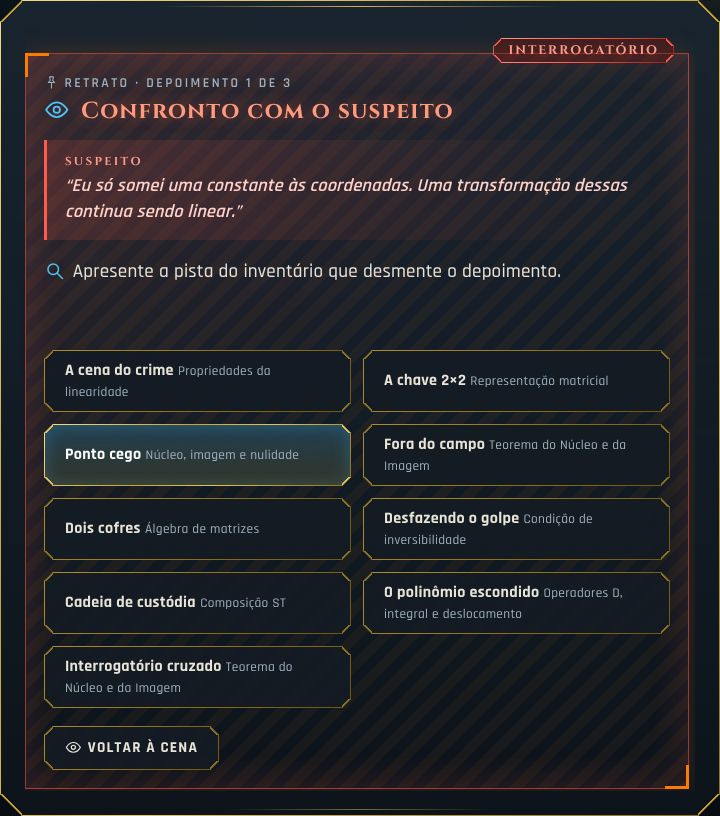

# Caso Kernel

**Um jogo de investigação noir para estudar Álgebra Linear.** O jogador explora cenas point and click, examina objetos e resolve um problema de matemática para cada pista. Ferramentas interativas em 2D e 3D ajudam a enxergar o que cada conta significa.

### ▶ [Jogar agora: case-kernel.vercel.app](https://case-kernel.vercel.app/)

Funciona no navegador, no computador e no celular, sem instalar nada. Depois da primeira visita, também funciona offline.



## Os casos

Cada caso tem 10 pistas, da mais fácil ao chefão, e termina com um interrogatório do suspeito.

| Caso | Cenário | Conteúdo |
|---|---|---|
| 🗝️ **O Cofre Vazio** | Escritório do cofre arrombado | Linearidade, matriz canônica, núcleo e imagem, teorema do núcleo e da imagem, produto de matrizes, composição e inversa |
| 👻 **A Matriz Fantasma** | Palco do teatro e biblioteca | Inversa, ordem da matriz, potências Aⁿ, derivação na base (sen, cos), identidades com matrizes, operadores D e integral |
| 🧬 **A Dependência Letal** | Laboratório e câmara fria | Espaço-linha, dependência linear, posto, nulidade, composição, deslocamento de polinômios |
| 🔭 **O Observatório Quadrático** | Cúpula do telescópio e sala de mapas | Autovalores e autovetores, polinômio característico, mudança de base, matrizes hermitianas e ortogonais, formas quadráticas, cônicas, quádricas e mínimos quadrados |

| | |
|---|---|
|  |  |

## Como se joga

- **Explorar a cena:** clique nos objetos. Os que estão destacados podem ser examinados; os trancados precisam de outras pistas antes. A tecla `H` destaca todos os objetos.
- **Resolver a pista:** cada objeto abre um problema. Respostas com vários números vão separadas por vírgula (`3,1`); frações são aceitas (`1/2`); com vírgula decimal, separe os números com ponto e vírgula (`2; 1,5`). Uma prévia mostra o que será enviado.
- **Dossiê:** cada pista resolvida vira uma ficha com o conceito-chave e uma dica de prova.
- **Interrogatório:** antes do chefão, o suspeito mente três vezes. Apresente a pista do inventário que desmente cada afirmação.
- **Modos:**
  - **Detetive:** erros e dicas custam vida.
  - **Investigador:** sem perda de vida, para estudar no próprio ritmo.
  - **Time Attack:** 3 minutos de problemas sorteados de todos os casos.
- **Errou?** Se a pista tem uma ferramenta visual, o jogo sugere abri-la logo depois do erro.
- **Números sorteados:** a cada partida, 22 dos 40 problemas mudam de números, então não dá para decorar as respostas.
- **Modo Revisão:** os conceitos em que você errou ou pediu dica, em qualquer modo, voltam em sessões curtas com números novos e a explicação de cada um. Acertar de primeira adia a próxima revisão (1, 3, 7 e depois 14 dias); errar faz o conceito voltar logo. O progresso fica no seu navegador.
- **Desafio da turma:** na tela de casos, **Criar desafio** gera um link como `case-kernel.vercel.app/?desafio=K7XQ2M&v=1`. Todos que abrirem o link recebem os mesmos números nos casos e no Time Attack. No fim, **Copiar resultado** gera um texto com pontos, tempo, erros e conceitos a revisar para colar no grupo da turma.

## Ferramentas para enxergar a matemática

Em várias pistas, o botão **Abrir ferramenta** mostra o problema de forma visual. A resposta digitada continua sempre disponível.

| | |
|---|---|
|  |  |
|  |  |

- **No plano (2D):** núcleo (as direções que somem), ordem da composição, inversa com o paralelogramo do determinante, potências de uma matriz, luneta dos autovetores, grade de uma base nova, régua ortogonal, eixos de uma cônica e reta de mínimos quadrados.
- **Escalonamento:** operações elementares com frações exatas, desfazer e "sugerir passo".
- **Em 3D:** imagem de uma transformação, núcleo em ℝ³ e quádricas (com cortes e as retas do hiperboloide). O 3D só é baixado quando uma dessas ferramentas abre. Sem WebGL, ou com a preferência de menos movimento, aparece uma versão em SVG.

Tudo funciona por teclado: setas movem e giram, Enter confirma, Esc volta à cena.

## Rodar localmente

O jogo é HTML, CSS e JavaScript puros, sem etapa de build. Sirva a pasta com qualquer servidor local:

```bash
npx serve .
```

ou

```bash
python3 -m http.server 8000
```

Depois abra o endereço que aparecer (por exemplo, `http://localhost:8000`). Abrir o `index.html` direto do disco também funciona, mas o navegador bloqueia o 3D em WebGL e o modo offline nesse caso.

Para posicionar objetos na arte, adicione `?debug=1` ao endereço: as caixas dos objetos clicáveis e as coordenadas do cursor aparecem sobre a cena.

## Testes

```bash
npm install
```

```bash
npx playwright install chromium
```

```bash
npm test
```

- **`npm run validate`** (`tools/validate.js`): confere a estrutura de todos os casos e cenas. Também recalcula cada resposta de forma independente, incluindo 300 versões de cada problema sorteado, e confirma que cada ferramenta chega na resposta certa.
- **`npm run smoke`** (`tools/smoke.js`): joga todos os casos no Chromium, erra e pede dica de propósito, usa cada ferramenta e recarrega no meio da partida. `npm run smoke:mobile` faz o mesmo em tela de celular.

Os dois rodam automaticamente no GitHub a cada push e pull request.

O validador também guarda em `tools/sorteios.json` o que cada gerador de problema produz. Se um gerador mudar sem subir `SORTEIO_VERSAO` em `cases.js`, a validação falha: assim, um link de desafio nunca muda de números sem aviso. Ao mudar um gerador de propósito, suba a versão e rode `node tools/validate.js --atualizar-sorteios`.

## Estrutura

| Arquivo | O que tem |
|---|---|
| `index.html` | Página, ícones e modais |
| `style.css` | Visual Art Déco noir |
| `cases.js` | Os problemas de cada caso (`SEEDS`) e as fichas do dossiê (`FL`) |
| `scenes.js` | As salas em SVG, os objetos clicáveis, as falas e os interrogatórios |
| `tools2d.js` | Ferramentas no plano e a lupa de escalonamento |
| `tools3d.js` | Ferramentas 3D (Three.js sob demanda, com reserva em SVG) |
| `script.js` | O motor: estado e save, cenas, painéis, modos, áudio |
| `sw.js` | Service worker para jogar offline |
| `vendor/` | Three.js r160 (versão fixa) |
| `fonts/` | Cinzel e Rajdhani (subconjunto latino) |
| `tools/` | Validador e teste de fumaça |

Quer criar um problema, um caso ou uma cena? Veja o [guia de contribuição](CONTRIBUTING.md).

## Créditos

- Arte das cenas: original, em SVG feito à mão.
- Fontes [Cinzel](https://github.com/NDISCOVER/Cinzel) e [Rajdhani](https://fonts.google.com/specimen/Rajdhani), sob a SIL Open Font License (`fonts/OFL-*.txt`).
- [Three.js](https://threejs.org/), sob a licença MIT (`vendor/three-LICENSE.txt`).

## Licença

Ainda não definida. Até que um arquivo `LICENSE` seja adicionado, todos os direitos ficam reservados ao autor.
